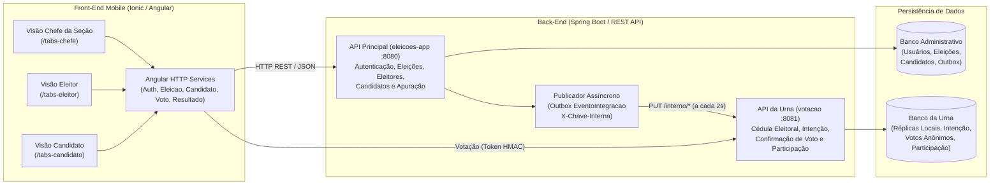
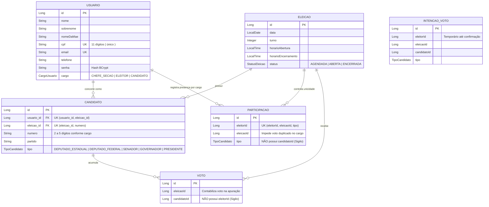

Sistema de Simulação de Eleição Eletrônica
Este repositório contém o projeto do Sistema de Simulação de Eleição Eletrônica, desenvolvido para aplicar de forma prática os conceitos de Programação Modular: modularização, organização em camadas, persistência de dados, controle de acesso por perfil, garantia de sigilo do voto, testes automatizados (unitários e de integração), versionamento e documentação de serviços.
O sistema permite o gerenciamento completo do processo eleitoral (cadastro, abertura e encerramento de eleições), o cadastro de participantes (Eleitores e Candidatos) e a realização de votações eletrônicas com apuração de resultados em tempo real e exibição do vencedor após o encerramento.
---
Integrantes do Grupo
Izadora Queiros
Jonathan Souza
Leticia Martins
Matheus Gazitua
Rafael Tavares
---
Tecnologias Utilizadas
Front-End (`main` / `mobile`)
Ionic Framework 9 (Componentes de UI mobile)
Angular 22 (Standalone Components, Services, Router, Forms)
TypeScript 6, HTML5 e SCSS/CSS
JSON Server (`fake-api/db.json` para simulação REST local do Front-End)
Vitest (Testes unitários) e Playwright (Testes E2E)
Back-End (`api/eleicoes-app` e `api/votacao` na branch `desenvolvimento`)
Java 17+
Spring Boot 3 / 4 (Spring Web MVC, Spring Security, Spring Data JPA, Bean Validation)
Banco de Dados Relacional: H2 Database / SQLite (persistência via Hibernate/JPA)
Autenticação e Segurança: HTTP Basic (administração), Token HMAC-SHA256 (`HS256`) stateless para eleitores e cabeçalho `X-Chave-Interna` para comunicação entre serviços
Testes: JUnit 5 e Spring MockMvc (`@SpringBootTest`, `@AutoConfigureMockMvc`)
Documentação da API: OpenAPI 3 / Swagger UI (`springdoc-openapi`)
---
Pré-requisitos
Para executar o projeto localmente, você pode utilizar Node.js + Java/Maven instalados na máquina ou rodar via Docker / Podman:
Node.js (v22.22+ ou v24+) e `npm`
Ionic CLI (`npm install -g @ionic/cli`) ou Angular CLI (`npx ng`)
Java JDK 17+ e Maven (ou o wrapper `./mvnw` incluso no projeto)
(Opcional) Podman ou Docker para rodar sem instalar dependências locais
---
Como Executar o Projeto
Opção 1: Rodando Front-End + Fake API com Podman ou Docker (Sem instalar Node local)
Na raiz do projeto, execute:
```bash
podman run -d --name eleicao-app \
  -p 4200:4200 -p 3000:3000 \
  -v "$(pwd):/app" -w /app \
  docker.io/library/node:24-alpine \
  sh -c "npm ci && (npx --yes json-server@0.17.4 --host 0.0.0.0 --port 3000 --watch fake-api/db.json &) && npx ng serve --host 0.0.0.0 --port 4200"
```
Front-End (Aplicação): `http://localhost:4200`
Fake API REST (`json-server`): `http://localhost:3000`
Opção 2: Rodando Front-End + Fake API Localmente (Node.js)
Instale as dependências na raiz do projeto:
```bash
   npm install
   ```
Inicie a Fake API (`json-server`) na porta `3000`:
```bash
   npx json-server@0.17.4 --watch fake-api/db.json --port 3000
   ```
Em outro terminal, inicie o servidor do Front-End Ionic/Angular:
```bash
   npm start
   # ou: ionic serve
   ```
Acesse em `http://localhost:4200` (ou `http://localhost:8100` via `ionic serve`).
Opção 3: Rodando o Back-End Spring Boot (Branch `desenvolvimento`)
O Back-End é dividido em dois processos independentes: o serviço administrativo/monólito (`api/eleicoes-app`, porta `8080`) e o serviço isolado de urna/votação (`api/votacao`, porta `8081`).
Iniciar o serviço principal (`eleicoes-app` — porta `8080`):
```bash
   cd api/eleicoes-app
   ./mvnw spring-boot:run
   ```
Iniciar o serviço de Urna/Votação (`votacao` — porta `8081`):
```bash
   cd api/votacao
   ./mvnw spring-boot:run
   ```
Executar a suíte de testes automatizados (Unitários e Integração):
```bash
   cd api/eleicoes-app && ./mvnw test
   cd ../votacao && ./mvnw test
   ```
Credenciais de Teste (Ambiente Local / Fake API)
Perfil	Login	Senha	Rota Principal	Permissões
Chefe da Seção	`chefe`	`123`	`/tabs-chefe`	Cadastrar/abrir/encerrar/excluir eleições; cadastrar/editar/excluir eleitores e candidatos; consultar resultados gerais.
Eleitor	`eleitor`	`123`	`/tabs-eleitor`	Votar 1 única vez por cargo em eleições com status `ABERTA`; acompanhar evolução da votação de todos os cargos.
Candidato (Presidente)	`10`	`10`	`/tabs-candidato`	Acompanhar exclusivamente a evolução da votação do cargo ao qual concorre (Presidente da República).
Candidato (Governador)	`12`	`12`	`/tabs-candidato`	Acompanhar exclusivamente a evolução da votação do cargo ao qual concorre (Governador).
---
Arquitetura do Sistema
O sistema foi projetado seguindo uma arquitetura cliente-servidor desacoplada via API REST (JSON), com separação adicional no Back-End para isolar o caminho crítico da Urna de Votação:

Principais Decisões Arquiteturais
Separação entre Front-End e Back-End:
Front-End (Ionic/Angular): Responsável pela experiência mobile e controle de navegação por perfil (`CHEFE`, `ELEITOR`, `CANDIDATO`). Comunica-se exclusivamente via requisições HTTP (`HttpClient`) consumindo e enviando JSON.
Back-End (Spring Boot): Concentra as regras de negócio, validações de domínio (CPF, compatibilidade de número eleitoral por cargo, transições de status da eleição), segurança e persistência transacional.
Isolamento do Serviço de Urna (`api/votacao`):
O cadastro administrativo, abertura/encerramento de eleições e apuração ficam no serviço principal (`api/eleicoes-app`, porta `8080`).
A recepção de votos fica isolada no serviço de Urna (`api/votacao`, porta `8081`), que mantém réplicas locais dos dados necessários (`EleicaoLocal`, `CandidatoLocal`, `EleitorLocal`) sincronizadas via padrão Transactional Outbox (`EventoIntegracao` publicado a cada 2 segundos com cabeçalho `X-Chave-Interna`) e valida o token HMAC (`HS256`) localmente sem depender de chamadas síncronas ao serviço de login no momento do voto.
Caso um candidato já possua votos confirmados na urna (`GET /interno/candidatos/{id}/possui-votos`), sua exclusão é bloqueada (`409 Conflict`) para preservar a integridade da apuração.
---
Modularização
O projeto aplica o princípio de Alta Coesão e Baixo Acoplamento, dividindo responsabilidades claramente em módulos e camadas tanto no Front-End quanto no Back-End.
1. No Front-End (`src/app/`)
`models/` (`usuario.model.ts`, `eleicao.model.ts`, `candidato.model.ts`, `voto.model.ts`): Interfaces e tipos TypeScript que definem os contratos de dados.
`services/` (`auth.service.ts`, `eleicao.ts`, `candidato.ts`, `voto.ts`, `resultado.ts`): Camada de comunicação HTTP com a API REST e gerenciamento de sessão do usuário autenticado (`BehaviorSubject` + `localStorage`).
`pages/`: Componentes Standalone do Ionic/Angular organizados por funcionalidade e perfil:
`login/`: Autenticação e redirecionamento automático conforme o perfil (`CHEFE`, `ELEITOR`, `CANDIDATO`).
`integrantes/`: Identificação dos membros da equipe.
`tabs-chefe/`: Container de navegação do Chefe da Seção.
`gerenciar-eleicao/`: Criação de eleições (`AGENDADA`), abertura (`ABERTA`), encerramento (`ENCERRADA`) e exclusão.
`cadastrar-usuario/`: CRUD completo de Eleitores e Candidatos (associados a número, partido e cargo).
`tabs-eleitor/` e `votacao/`: Listagem de eleições `ABERTA`s, exibição dos candidatos por cargo, registro de voto único por cargo e feedback com preservação do sigilo.
`tabs-candidato/` e `resultados/`: Acompanhamento da apuração em tempo real (visão global para Chefe/Eleitor e visão filtrada apenas para o cargo disputado quando o usuário é `CANDIDATO`), destacando o vencedor quando a eleição está `ENCERRADA`.
`app.routes.ts`: Definição centralizada das rotas com Lazy Loading (`loadComponent`) por página.
2. No Back-End (`api/eleicoes-app` e `api/votacao`)
Cada serviço Spring Boot é estruturado em pacotes por camada:
`controller/` (ou `web/`): Camada de entrada REST (`AutenticacaoController`, `EleicaoController`, `EleitorController`, `CandidatoController`, `ApuracaoController`, `ResultadoController`, `UrnaController`, `ReplicaController`). Recebe DTOs validados e retorna códigos HTTP semânticos (`200`, `201`, `204`, `400`, `401`, `403`, `404`, `409`).
`service/`: Camada de regras de negócio e orquestração transacional (`AutenticacaoAplicacaoService`, `CandidatoService`, `UrnaService`, `ReplicaService`).
`repository/`: Interfaces Spring Data JPA (`UsuarioRepository`, `EleicaoRepository`, `CandidatoRepository`, `VotoRepository`, `ParticipacaoRepository`, `IntencaoVotoRepository`, `EventoIntegracaoRepository`) para acesso desacoplado ao banco de dados.
`domain/` (e `domain/Enum/`): Entidades JPA (`Usuario`, `Eleicao`, `Candidato`, `Voto`, `Participacao`, `IntencaoVoto`) e enumerações do minimundo (`CargoUsuario`, `StatusEleicao`, `TipoCandidato`).
`dto/`: Objetos de transferência de dados (`Request` e `Response` records) que evitam expor entidades de persistência diretamente na API.
`validation/`: Anotações e validadores customizados do Bean Validation (`@Cpf`, `CpfValidator`, `CpfUtils`, `@NumeroCompativel`, `RegrasNumeroCandidato` que valida a quantidade de dígitos do número eleitoral por cargo: 2 para Presidente/Governador, 3 para Senador, 4 para Deputado Federal, 5 para Deputado Estadual).
`security/` e `config/`: Configuração do Spring Security (`SecurityConfig`), emissão e validação de tokens HMAC (`EmissorToken`, `AutenticacaoService`), filtro de chave interna (`ChaveInternaFilter`) e tratamento global padronizado de erros (`ApiExceptionHandler`).
`integracao/`: Implementação do padrão Outbox (`EventoIntegracao`, `PublicadorVotacao`, `IntegracaoVotacao`) para sincronização resiliente entre o cadastro e a urna.
---
Modelagem do Banco de Dados
A modelagem foi construída para atender todas as regras do minimundo, com destaque para a separação física entre o registro de participação do eleitor e o voto computado, garantindo matematicamente o sigilo do voto e impedindo votos duplicados.

Descrição das Entidades e Restrições de Integridade
`Usuario` (`usuarios`):
Armazena todos os atores do sistema diferenciados pelo perfil (`CHEFE_SECAO` / `CHEFE`, `ELEITOR`, `CANDIDATO`).
Possui restrição de unicidade (`UNIQUE`) para `cpf` (validado pelos dígitos verificadores) e `email`, além de senha criptografada com `BCrypt`.
`Eleicao` (`eleicoes`):
Representa um pleito com `data`, `turno`, `horarioAbertura`, `horarioEncerramento` e `status` (`AGENDADA`, `ABERTA`, `ENCERRADA`).
Nasce sempre com status `AGENDADA` e somente o Chefe da Seção pode transicionar para `ABERTA` e posteriormente para `ENCERRADA`.
`Candidato` (`candidatos`):
Vincula um `Usuario` a uma `Eleicao` (`ManyToOne`), contendo `numero`, `partido` e `tipo` (cargo disputado: `DEPUTADO_ESTADUAL`, `DEPUTADO_FEDERAL`, `SENADOR`, `GOVERNADOR` ou `PRESIDENTE`).
Restrições de Unicidade Composta (`@UniqueConstraint`):
`(usuario_id, eleicao_id)`: Um usuário só pode ser candidato a um único cargo por eleição.
`(eleicao_id, numero)`: Dois candidatos não podem ter o mesmo número na mesma eleição.
`Participacao` e `Voto` (Mecanismo de Sigilo do Voto):
`IntencaoVoto`: Registro transitório criado quando o eleitor seleciona o candidato antes de confirmar.
`Participacao`: Ao confirmar o voto, grava apenas `(eleitorId, eleicaoId, tipo)` com restrição `UNIQUE (eleitorId, eleicaoId, tipo)`. Isso garante que o eleitor vote uma única vez para cada cargo naquela eleição, mas não armazena em quem ele votou.
`Voto`: Grava apenas `(eleicaoId, candidatoId)`, sem nenhuma chave estrangeira ou referência ao `eleitorId`. Assim, o voto confirmado é irreversível e totalmente anônimo.
---
Organização dos Testes Automatizados
O projeto diferencia claramente Testes Unitários de Testes de Integração / E2E:
Tipo de Teste	Onde fica	Ferramentas	O que valida
Unitários (Back-End)	`api/eleicoes-app/src/test/.../validation/CpfUtilsTest.java`	JUnit 5	Validação isolada de regras puras (cálculo de dígitos verificadores de CPF, formatação e regras de dígitos de número eleitoral por cargo) sem subir Spring ou banco.
Integração (Back-End)	`CandidatoControllerTest.java` e `UrnaControllerTest.java`	`@SpringBootTest`, `MockMvc`, H2 in-memory	Sobe o contexto Spring completo com perfil `test`, testa autenticação/autorização por perfil (`401`/`403`), persistência JPA, constraints de conflito (`409`), fila Outbox e fluxo de registro + confirmação de voto anônimo na urna.
Unitários (Front-End)	`src/app/**/*.spec.ts`	Vitest + Angular `TestBed`	Criação e comportamento isolado dos componentes de página (`LoginPage`, `GerenciarEleicaoPage`, `CadastrarUsuarioPage`, `TabsChefePage`, `TabsCandidatoPage`, `IntegrantesPage`).
E2E (Front-End)	`e2e/app.spec.ts`	Playwright	Fluxo de navegação real da aplicação renderizada no navegador.
---
Documentação da API e Testes em Ferramentas REST (Postman / Insomnia / Swagger)
A API pode ser testada diretamente via Postman, Insomnia ou Swagger UI:
Endpoints da Fake API (`http://localhost:3000`):
`GET /usuarios` | `POST /usuarios` | `PUT /usuarios/{id}` | `DELETE /usuarios/{id}`
`GET /eleicoes` | `POST /eleicoes` | `PATCH /eleicoes/{id}` | `DELETE /eleicoes/{id}`
`GET /candidatos` | `POST /candidatos` | `PUT /candidatos/{id}`
`GET /votos?eleitorId={id}` | `POST /votos`
Endpoints do Back-End Spring Boot (`:8080` e `:8081`):
Autenticação: `POST /auth/login` (retorna Token HMAC `HS256` com `sub` e `cargo`)
Candidatos (`:8080`): `POST /candidatos`, `GET /candidatos`, `GET /candidatos/{id}`, `PUT /candidatos/{id}`, `DELETE /candidatos/{id}`
Eleições, Eleitores e Resultados (`:8080`): `/eleicoes`, `/eleitores`, `/apuracao`, `/resultados`
Urna Eletrônica (`:8081`):
`GET /eleicoes/{id}/candidatos` (Cédula eleitoral da eleição aberta)
`POST /eleicoes/{id}/votos` (Registra intenção de voto)
`POST /eleicoes/{id}/votos/confirmacao` (Confirma voto anônimo, grava participação única e apaga intenção)
Swagger UI (OpenAPI 3): `http://localhost:8080/swagger-ui.html` (Monólito) e `http://localhost:8081/swagger-ui.html` (Urna).
